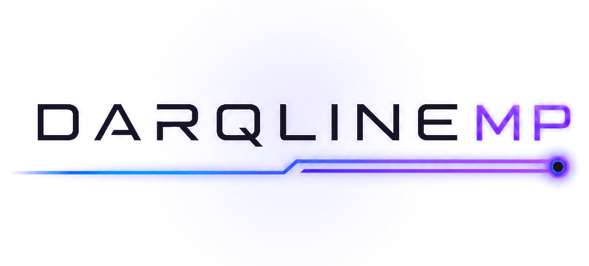

  <picture>
    <source media="(prefers-color-scheme: dark)" srcset="https://github.com/user-attachments/assets/7130d03f-ab2e-4876-9e11-7fa40b15b604" />
    
  </picture>

### Multiplayer for Grand Theft Auto: San Andreas – The Definitive Edition

DarqlineMP is now in public alpha on Windows. Play for free on the official server or host your own and write game modes in Lua.

**[Download](https://darqline.com/download)** · [Documentation](https://docs.darqline.com/) · [Server](https://github.com/DarqlineMP/server) · [Launcher source](https://github.com/DarqlineMP/launcher) · [Bug reports](https://github.com/DarqlineMP/releases/issues)

 

 

DarqlineMP is a free, non-commercial project developed independently of Rockstar Games and Take-Two Interactive. 
Grand Theft Auto and Grand Theft Auto: San Andreas are trademarks of Take-Two Interactive Software, Inc.

